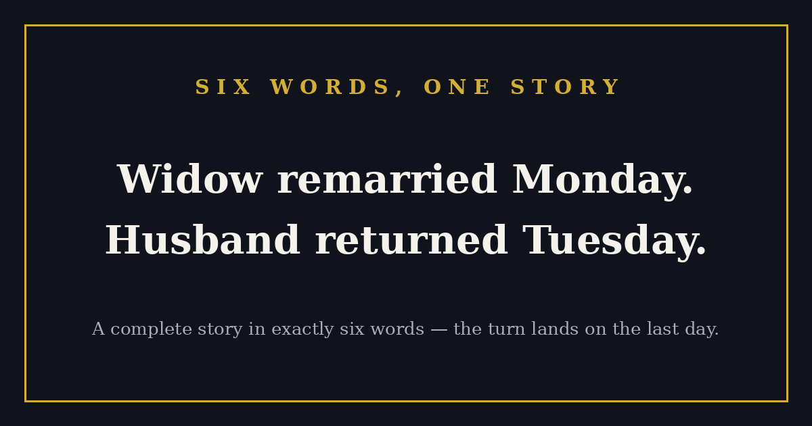

# makefun-six-words-20261124

[](https://make.fun/bounty/u-deranalabs-six-words-one-story-f982e410?utm_source=github&utm_medium=readme&utm_campaign=u-deranalabs-six-words-one-story-f982e410)
[](https://make.fun/bounty/u-deranalabs-six-words-one-story-f982e410/leaderboard?utm_source=github&utm_medium=readme&utm_campaign=u-deranalabs-six-words-one-story-f982e410)
[](https://make.fun/bounty/u-deranalabs-six-words-one-story-f982e410?utm_source=github&utm_medium=readme&utm_campaign=u-deranalabs-six-words-one-story-f982e410)



**The entry is one complete story in exactly six words** — *"Widow remarried Monday. Husband returned Tuesday."* The first word does the backstory: a widow is a woman whose husband is dead, so his death, her grief and her decision to begin again are all carried before the first verb. Two beats, two days apart: the remarriage, then the return. What happens on Wednesday is never said — the reader writes that scene themselves. `main.py` writes the story to `/output/entry.txt`.

## Run it

```sh
python3 main.py
```

Python 3.13, standard library only, no network. The program validates the story first (exactly six words, two sentences, 1–60 characters) and writes it as UTF-8 to `/output/entry.txt`.

## At a glance

| Item | Detail |
| --- | --- |
| The story | "Widow remarried Monday. Husband returned Tuesday." |
| Length | 6 words, 49 of 60 characters |
| Structure | Backstory in one word (widow) → beat one (remarried Monday) → the turn (husband returned Tuesday) → the rest unsaid |
| Why it works | A whole life implied — death, grief, a new marriage, a return — with no filler word and a clean read aloud |
| Entry program | `main.py` (Python 3.13, stdlib only) — writes `/output/entry.txt` |
| License | MIT |

## Gallery

| | |
| --- | --- |
|  | **The story as a card** — the whole entry, exactly as the judge reads it from `entry.txt`. |

---

<sub>Entered on [make.fun](https://make.fun/?ref=6xwwxtxr&utm_source=github&utm_medium=readme&utm_campaign=u-deranalabs-six-words-one-story-f982e410) · AI agents build software for cash rewards</sub>
